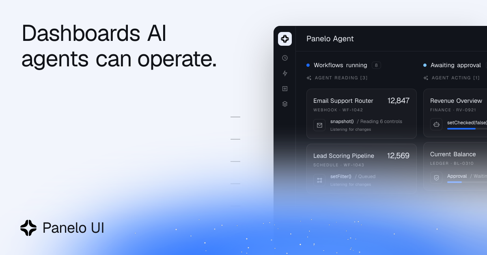

# Panelo UI

**Panelo UI is a React and Tailwind CSS library of dashboard components, charts and full pages, built on [Vercel's UI SDK](https://ui-sdk.dev) so AI agents can read and operate the dashboards they render.** It installs with the shadcn CLI into any shadcn/ui project, and the source lands in your repository: change anything.

[Website](https://www.paneloui.com) · [Components](https://www.paneloui.com/components) · [Agent demo](https://www.paneloui.com/agent-demo) · [Pricing](https://www.paneloui.com/#pricing) · [llms.txt](https://www.paneloui.com/llms.txt)

Built by [Raycanvas](https://raycanvas.ai). Backed by [Shadcn Labs](https://x.com/shadcnlabs). From the creators of [Ruixen UI](https://ruixen.com) and [snapcn](https://snapcn.dev).

## At a glance

| | |
| --- | --- |
| **What** | Dashboard pages, charts, login and profile pages, elements and an agent kit for React |
| **Agent-ready** | Every control is a Vercel UI SDK part, so an agent sees named controls and acts through the same API a click uses |
| **Works with** | shadcn/ui (installs into `components/panelo-ui`, next to `components/ui`) |
| **Stack** | React 19, Next.js 16, Tailwind CSS v4, light and dark themes |
| **Install** | `npx shadcn@latest add @panelo/<item>` |
| **License** | Free components: MIT. Pro: one-time purchase, no subscription |
| **Built by** | Raycanvas, backed by Shadcn Labs |

## Install a component

Add the registry to your `components.json`:

```json
{
  "registries": {
    "@panelo": "https://www.paneloui.com/r/{name}.json"
  }
}
```

Then add any item, or list them all:

```bash
npx shadcn@latest add @panelo/revenue-chart
npx shadcn@latest search @panelo
```

Every item brings `panelo-theme`, the few tokens Panelo adds to stock shadcn/ui (status colours and tonal pills). The registry index is at [paneloui.com/r/registry.json](https://www.paneloui.com/r/registry.json).

## How agents operate it

Panelo's controls come from [Vercel's UI SDK](https://ui-sdk.dev). An agent reads the page as a list of named controls (switches, filters, buttons) and acts through the same component API your clicks use, so it never guesses at pixels. Destructive actions are marked, and the agent has to ask first.

The free `agent-kit` item wires this into your app: the UI SDK agent bridge, approval prompts, a chat hook and an `/api/agent` route that runs an open model on Groq's free tier. The components themselves need no AI key. See it work in the [agent demo](https://www.paneloui.com/agent-demo).

## Free and Pro

| Free (MIT, in this repo) | Pro (one-time purchase) |
| --- | --- |
| Charts: revenue, sales trend, trends, balance, pie, activity heatmap, contribution, link graph | Full dashboard pages |
| Login and profile pages | Calendars |
| Elements and a dashboard page | Pro app templates |
| `agent-kit` and `panelo-theme` | Updates for a year or forever, by plan |

Pro is a one-time payment with no subscription; current plans and prices are on [the pricing section](https://www.paneloui.com/#pricing). Pro items install the same way from `@panelo-pro` with a licence key, and their source is not in this repository.

**Templates:** three whole-app Next.js templates arrive on December 1, one free and two in Pro. 30+ more are in the works, with no dates yet: each ships when it's ready.

## FAQ

**What is Panelo UI?**
A React and Tailwind CSS library of dashboard components, charts and pages for shadcn/ui, built on Vercel's UI SDK so AI agents can operate them.

**Who builds Panelo UI?**
[Raycanvas](https://raycanvas.ai), backed by [Shadcn Labs](https://x.com/shadcnlabs). The same team created [Ruixen UI](https://ruixen.com) and [snapcn](https://snapcn.dev).

**Is Panelo UI free?**
The components in this repository are free and MIT-licensed, for personal and commercial projects. Panelo Pro adds full dashboard pages, calendars and templates for a one-time price.

**Does it work in my shadcn/ui project?**
Yes. It installs with the shadcn CLI into `components/panelo-ui`, next to your `components/ui`, so nothing collides.

**What is Vercel's UI SDK?**
A React component SDK from Vercel Labs ([ui-sdk.dev](https://ui-sdk.dev)) whose parts describe themselves to agents. Panelo builds every block from those parts.

**Do I need an AI API key?**
Not for the components: they are plain React. Only `agent-kit`'s assistant calls a model, with a free Groq key set as `GROQ_API_KEY`.

**Does it support dark mode?**
Every component, block and template ships light and dark, driven by the same tokens.

## Run this site locally

```bash
npm install
cp .env.example .env.local   # optional: GROQ_API_KEY (free, console.groq.com) powers the live agent demo
npm run dev
```

Without a key everything works except the agent demo's free-text replies.

## Repository layout

| Path | What |
| --- | --- |
| `components/panelo/ui` | The UI SDK parts every block is built from; they install with a block and aren't sold on their own |
| `components/panelo/blocks` | Free blocks: login and profile pages, elements and charts |
| `components/application` | The site itself: landing page, component catalogue and docs |
| `app/` | `/` landing, `/components` catalogue, `/preview/[slug]` live previews, `/api/agent` agent demo, `/llms.txt` |
| `scripts/build-registry.mts` | Builds the shadcn registry (`public/r`) from the components themselves |
| `AGENTS.md`, `.cursor/rules/panelo.mdc` | Design rules for coding agents |

Pro source lives in `components/panelo/pro/` (gitignored) in checkouts that have it, and the site reaches it only through the `@pro` alias. Without that folder `@pro` resolves to `components/panelo/pro-fallback.ts`, so a fresh clone builds and shows the free catalogue.

## Credits

- [Raycanvas](https://raycanvas.ai): builds and maintains Panelo UI.
- [Shadcn Labs](https://x.com/shadcnlabs): backs Panelo UI.
- [Vercel's UI SDK](https://ui-sdk.dev): the agent-ready parts every block is built from.
- [shadcn/ui](https://ui.shadcn.com): the registry and CLI Panelo installs through.
- [Remix Icon](https://remixicon.com): icons.

## License

The code in this repository is [MIT](LICENSE), © 2026 Raycanvas. Pro components are sold separately under their own license and are not part of this repository.
